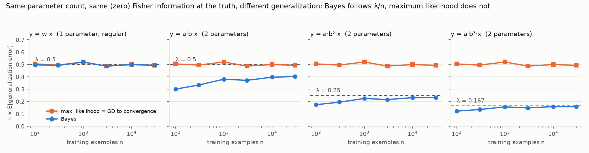
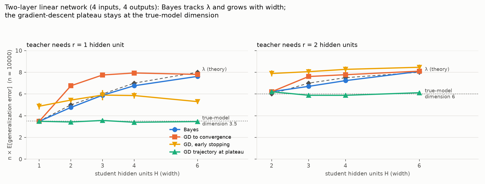
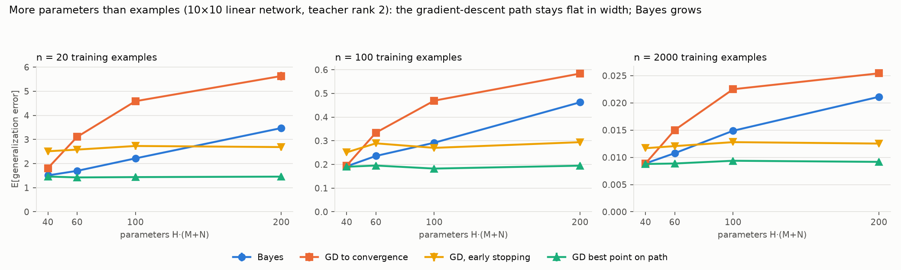
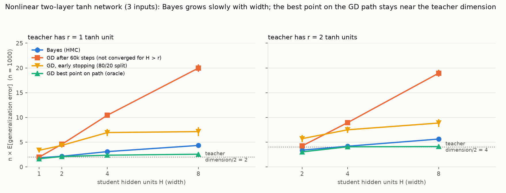
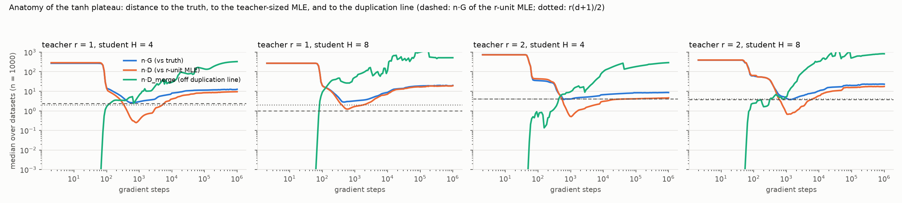

# Why a small overparameterized network generalizes: Bayes, λ, and the gradient-descent plateau

Status, 2026-10-24.

| Piece | Status |
| --- | --- |
| Bayes error `→ λ/n` (Watanabe) | Cited in general; **for the toy models, the limiting identity `E[m(z)²] = α` (so `λ = α/2`) is proved in Lean**: `OpenTheory.BayesToy.bayes_second_moment` |
| `λ(M,N,H,r)` formula (Aoyagi & Watanabe 2005) | Cited; our Lean and Python versions agree on 2,205 values, and Bayes runs match it in 14 configurations |
| `λ ≥ r(M+N−r)/2 + 1/2` when `r < min(M,N)`, `H > r` | **Lean**: `OpenTheory.RRR.rlct8_gain` |
| Mode dynamics `ẇ = 2w(σ−w)` solved by the logistic | **Lean**: `OpenTheory.Plateau.hasDerivAt_mode`, `mode_zero` |
| Plateau: signal modes learned, noise modes off, uniformly on the window | **Lean**: `OpenTheory.Plateau.plateau` |
| Aligned, balanced flow decouples into modes; existence and uniqueness of the flow; reduction of any data to diagonal by its SVD | **Lean**: `OpenTheory.Plateau.flow_decouples`, `flow_exists`, `unique_of_contDiff`, `rotate_solves`; end to end for the network product: `flow_plateau`. Cross-checked numerically (Runge–Kutta on rotated data: max deviation 3·10⁻¹³) |
| Statistics of the rank-`r` fit (`n·E[G] → r(M+N−r)/2`) | **Lean** for the threshold-truncated SVD (keep `σ² ≥ τ`, any fixed `0 < τ < s_r(W₀)²`) under i.i.d. Gaussian noise: `OpenTheory.TruncationRank.tendsto_risk_iid` (`n·E‖Ŵₙ − W₀‖²_F → r(M+N−r)`), from the deterministic second-order bound `OpenTheory.Perturbation.second_order_bound` (Davis–Kahan, no smallness condition) and the Gaussian trace identity `OpenTheory.GaussianQuadratic.integral_norm_sq_map`. Equality with the gradient-descent plateau: next row |
| **End to end** (plateau = truncated SVD, its risk, comparison with λ) | **Lean**: `OpenTheory.Plateau.gd_plateau_end_to_end`. Off events of probability → 1, gradient flow from the aligned start reaches the truncated SVD at time `√(2/s₂)·log(1/ε)` as `ε → 0` (`plateau_eq_trunc`), its risk satisfies `n·E‖Ŵₙ − W₀‖²_F → r(M+N−r)`, and `λ ≥ r(M+N−r)/2 + 1/2`. Hypotheses that are not proved: initialization aligned with the data's singular vectors; all singular values of the data positive (true almost surely); the λ formula and Watanabe's `n·E[G_Bayes] → λ` are cited |
| Nonlinear (tanh) network | Experiment 4 (numerical only): Bayes grows slowly with width; the best point on the gradient-descent path stays near the teacher dimension; validation early stopping does not find it |
| **Stopping rule** (no oracle) | **Lean**: `OpenTheory.Plateau.stopping_rule_end_to_end`. Stop at 1.5× the first time the training loss falls below `ρ`; for any fixed `0 < ρ ≤ s₂/4`, with probability → 1 this gives the truncated SVD as `ε → 0`. Experiment 5: works, including from random initialization, whenever `ρ` is above the noise floor `≈ NM/(2n)` |
| Random initialization | **Lean, balanced case**: `OpenTheory.Plateau.balanced_plateau_eq_trunc`. From *any* balanced start `ε(A₀, B₀)` (`A₀A₀ᵀ = B₀ᵀB₀`, a full-dimensional family, no alignment with the data) whose signal directions `A₀v_k + B₀ᵀu_k` are linearly independent, gradient flow on the good event reaches the truncated SVD at time `√(2/s₂)·log(1/ε)`. Proof: balance is conserved, `P = ZZᵀ` (`Z = [Aᵀ; B]`) solves the matrix Riccati equation `Ṗ = SP + PS − P²` (`S` = dilation of the data), which has the closed form `P = e^{tS}Z₀(I + Z₀ᵀ∫₀ᵗe^{2sS}ds Z₀)⁻¹Z₀ᵀe^{tS}`; its entries are analysed on the window (`Riccati.Pc_entries_limit`). Generic (unbalanced) Gaussian initialization: known theorem (Jiang, Chen & Ding 2023), not formalized; experiment 5 shows the stopping rule works there too |

## The question

Generalization error behaves like `C / n` for `n` training examples. Classical
theory says `C = d/2` for `d` parameters, which is wrong for neural networks.
What is `C`, and why is it small?

## Three answers, one model

Model: a two-layer linear network `y = B A x + ε` (reduced-rank regression),
`M` inputs, `N` outputs, `H` hidden units; the teacher `W₀ = B₀A₀` has rank
`r < H`. Generalization error `G = E_x KL(q ‖ p) = ‖W − W₀‖²_F / 2`.

| Learner | `n·E[G] →` | Grows with width `H`? |
| --- | --- | --- |
| Gradient descent to convergence (= maximum likelihood) | close to `MN/2` (all of `W`) | yes |
| Bayes, any prior with positive density at the truth | `λ(M,N,H,r)` (Watanabe; Aoyagi & Watanabe 2005) | yes |
| Gradient descent from small initialization, on its plateau | `r(M+N−r)/2`, the dimension of the rank-`r` matrices | **no** |

`λ > r(M+N−r)/2` whenever `r < min(M,N)` and `H > r` (checked for all
`M, N ≤ 40`, `H ≤ 60`: 1.1M cases, gap at least `1/2`), so small-initialization
gradient descent stopped on its plateau generalizes strictly better than Bayes
in every overparameterized case.

**Mechanism.** From a small initialization, gradient descent learns the
empirical singular directions one at a time, strongest first. Signal
directions (singular values of order 1) are learned after time
`≈ log(1/ε)`; noise directions (order `1/√n`) only after `≈ √n·log(1/ε)`. In
between, the network sits on a long plateau at the best rank-`r` fit: the
dynamics perform model selection. Bayes with a smooth prior cannot do this:
it averages over all submodels, weighted by their volume, and pays `λ`.

## Results

Scripts: `research/experiments/slt/`; raw results: `research/experiments/slt/results/`. Run on a
32-core GCP VM, about one hour in total.

**Experiment 1: the smallest singular models** (`toy_singular_1d.py`).
`y = a·bᵏ·x + noise`, true value 0, uniform prior; 4,000 datasets per point.
All four models have the same zero Fisher information at the truth.

| Model | Parameters | `λ` | Bayes `n·E[G]` (n = 30,000) | Maximum likelihood |
| --- | --- | --- | --- | --- |
| `y = w·x` | 1 | 0.5 | 0.49 | 0.49 |
| `y = a·b·x` | 2 | 0.5 (multiplicity 2) | 0.40 | 0.49 |
| `y = a·b²·x` | 2 | 0.25 | 0.23 | 0.49 |
| `y = a·b³·x` | 2 | 0.167 | 0.16 | 0.49 |

Bayes approaches `λ` from below; the remaining gap matches the predicted
finite-`n` corrections (relative order `n^{-1/4}` for `k = 2`; a `1/log n`
term for `k = 1`). The rescaled limit computed by quadrature gives 0.252 and
0.173 for `k = 2, 3`.

**Experiment 2: a two-layer linear network** (`rrr.py`), `M = N = 4`,
200 datasets per point, `n = 10,000`, values `n·E[G]`.

| `r` | `H` | `λ` | Bayes | GD to convergence | GD trajectory at plateau | GD, early stopping |
| --- | --- | --- | --- | --- | --- | --- |
| 1 | 1 | 3.5 | 3.48 | 3.48 | 3.48 | 4.87 |
| 1 | 2 | 5.0 | 4.76 | 6.76 | 3.42 | 5.44 |
| 1 | 3 | 6.0 | 5.89 | 7.75 | 3.56 | 5.90 |
| 1 | 4 | 7.0 | 6.76 | 7.94 | 3.40 | 5.86 |
| 1 | 6 | 8.0 | 7.62 | 7.81 | 3.46 | 5.30 |
| 2 | 2 | 6.0 | 6.21 | 6.21 | 6.21 | 7.89 |
| 2 | 3 | 7.0 | 6.70 | 7.61 | 5.88 | 8.06 |
| 2 | 4 | 7.5 | 7.23 | 7.78 | 5.88 | 8.27 |
| 2 | 6 | 8.0 | 8.08 | 8.10 | 6.12 | 8.46 |

Standard errors are 0.12–0.46. "GD trajectory at plateau" is the iterate of
random small-initialization gradient descent (scale `10⁻³`, unwhitened data)
closest to the best rank-`r` fit `Ŵᵣ`; its error equals that of `Ŵᵣ` in every
configuration. "Early stopping" trains on 80% of the `n` points and stops at
the lowest loss on the other 20%.

What the data say:

1. Bayes matches `λ` in all 14 configurations (`r = 0, 1, 2`).
2. Gradient descent to convergence equals maximum likelihood and is the worst.
3. The gradient-descent trajectory passes through the best rank-`r` fit at
   every width, so its best point sits at the true-model dimension
   `r(M+N−r)/2`, independent of `H` and below `λ`. This is the general
   (random initialization, unwhitened) case of the theorem below.
4. Locating the plateau with a validation split costs accuracy. That version
   is also flat in `H`, and beats Bayes once the student is well
   overparameterized (`r = 1, H ≥ 4`), but loses for mild overparameterization
   and for `r = 2`. A stopping rule that needs no held-out data is given in
   experiment 5 (and proved in Lean for whitened data).

## Theorem (clean case)

*Assumptions.* Whitened design: `XᵀX = n I_M`. Gaussian noise. Teacher of rank
`r` with fixed nonzero singular values. Let `Ĉ = YᵀX/n` with SVD
`Σᵢ σᵢ uᵢ vᵢᵀ`. Initialization aligned and balanced:
`A(0) = ε Σ_{i≤H} eᵢ vᵢᵀ`, `B(0) = ε Σ_{i≤H} uᵢ eᵢᵀ`. Gradient flow on
`L(A,B) = ½‖BA − Ĉ‖²_F`.

*1. Mode dynamics.* `W(t) = Σ_{i≤H} wᵢ(t) uᵢ vᵢᵀ` with
`ẇᵢ = 2wᵢ(σᵢ − wᵢ)`, `wᵢ(0) = ε²`, so
`wᵢ(t) = σᵢ / (1 + (σᵢ/ε² − 1) e^{−2σᵢ t})`.

Proof. Gradient flow is `Ȧ = Bᵀ(Ĉ − BA)`, `Ḃ = (Ĉ − BA)Aᵀ`. Try
`A = Σᵢ aᵢ eᵢvᵢᵀ`, `B = Σᵢ bᵢ uᵢeᵢᵀ` (`i ≤ H`; directions beyond `min(M,N)` get
`aᵢ = bᵢ = 0`). Then `Ĉ − BA = Σᵢ (σᵢ − aᵢbᵢ) uᵢvᵢᵀ + Σ_{i>H} σᵢuᵢvᵢᵀ`, and by
orthonormality `Bᵀ(Ĉ − BA) = Σᵢ bᵢ(σᵢ − aᵢbᵢ) eᵢvᵢᵀ` and
`(Ĉ − BA)Aᵀ = Σᵢ aᵢ(σᵢ − aᵢbᵢ) uᵢeᵢᵀ`: the ansatz is preserved if
`ȧᵢ = bᵢ(σᵢ − aᵢbᵢ)`, `ḃᵢ = aᵢ(σᵢ − aᵢbᵢ)`. This system has a global solution
from `aᵢ(0) = bᵢ(0) = ε` (it stays bounded, below), and since the flow's vector
field is polynomial, hence locally Lipschitz, it is the gradient flow. Along it
`d/dt (aᵢ² − bᵢ²) = 0`, so `aᵢ = bᵢ`, and `wᵢ = aᵢbᵢ = aᵢ²` satisfies
`ẇᵢ = 2aᵢȧᵢ = 2wᵢ(σᵢ − wᵢ)`, whose solution is the logistic above (bounded by
`max(σᵢ, ε²)`). Directions with `aᵢ = bᵢ = 0` stay at zero.

*2. Plateau.* If `σᵣ > σᵣ₊₁`, then for any `1/σᵣ < c₁ < c₂ < 1/σᵣ₊₁`,
`sup_{t ∈ [c₁ log(1/ε), c₂ log(1/ε)]} ‖W(t) − Ŵᵣ‖ → 0` as `ε → 0`, where
`Ŵᵣ = Σ_{i≤r} σᵢ uᵢ vᵢᵀ` is the best rank-`r` fit. Proof: at
`t = c log(1/ε)`, `e^{−2σᵢt} = ε^{2σᵢc}`. For a signal mode (`i ≤ r`, so
`σᵢc > 1` for every `c ≥ c₁`): `0 ≤ σᵢ − wᵢ(t) ≤ σᵢ²ε^{2σᵢc−2} ≤ σᵢ²ε^{2σᵢc₁−2} → 0`.
For a noise mode (`i > r`, so `σᵢc < 1` for every `c ≤ c₂`):
`0 ≤ wᵢ(t) ≤ σᵢε^{2−2σᵢc}/(σᵢ−ε²) ≤ σᵢε^{2−2σᵢc₂}/(σᵢ−ε²) → 0` (a mode with
`σᵢ = 0` decays from `ε²`). Both bounds are uniform on the window.

*3. Statistics.* `Ĉ = W₀ + Z/√n` with `Z` an `N×M` matrix of i.i.d. `N(0,1)`
entries. With probability `→ 1`, `σᵣ(Ĉ) → sᵣ(W₀) > 0` and
`σᵣ₊₁(Ĉ) = O(1/√n)`, so the plateau exists. The rank-`r` truncation is smooth
near `W₀`, with derivative the projection `P_T` onto the tangent space `T` of
the rank-`r` matrices at `W₀`, so `√n(Ŵᵣ − W₀) → P_T Z` in distribution.
Since `Ŵᵣ` is the best rank-`r` approximation of `Ĉ` and `W₀` has rank `r`,
`‖Ŵᵣ − W₀‖ ≤ 2‖Ĉ − W₀‖`, so `n‖Ŵᵣ − W₀‖² ≤ 4‖Z‖²`, which is integrable; by
dominated convergence `n·E‖Ŵᵣ − W₀‖² → E‖P_T Z‖² = dim T = r(M+N−r)`. The
plateau statement is on the event `σᵣ > σᵣ₊₁`, whose probability tends to 1.

*Formalized version of step 3.* `OpenTheory/Statistics/` proves, with standard
axioms only, the same limit for the hard-thresholded SVD
`Ŵₙ = P_{[τ,∞)}(ĈĈᵀ) Ĉ` with a fixed `0 < τ < s_r(W₀)²`:
`n·E‖Ŵₙ − W₀‖²_F → r(M+N−r)` (`tendsto_risk_iid`). The route avoids
"smoothness of truncation" and dominated convergence on a high-probability
event: a deterministic bound (`second_order_bound`)

  `‖Ŵ − W₀ − P_T(D)‖_HS ≤ (h_L h_R/δ²)‖W₀‖_HS + (h_L+h_R)(1/δ + 1/τ)‖D‖_HS`,

with `D = Ĉ − W₀`, `h_L = ‖ĈĈᵀ − W₀W₀ᵀ‖ ≤ ‖D‖(2‖W₀‖ + ‖D‖)` (same for `h_R`)
and `δ = s_r² − τ`, holds for every realization (Davis–Kahan from the vendored
SLT library plus the intertwining `P Ĉ = Ĉ Q`). So `√n(Ŵₙ − W₀) = P_T Z + R`
with `‖R‖ ≤ K(‖Z‖)/√n` for a polynomial `K`. The expectation is squeezed
between two integrals with envelope `c(1+‖Z‖)⁸` (Fernique gives all Gaussian
moments), and the limit `E‖P_T Z‖² = Σ_{k,l}(1 − ‖P⊥f_k‖²‖Q⊥e_l‖²) = NM − (N−r)(M−r)`
uses the trace of the spectral projections. `r` counts eigenvalues `≥ s_r²` of
`W₀W₀ᵀ`, and it equals the count for `W₀ᵀW₀` (`rankL_eq_rankR`). The expectation
is a lower Lebesgue integral, so the estimator's measurability is never needed.
For general Gaussian noise `Φ(x)` the limit is `Σₐ‖P_T Φ(gₐ)‖²` (`tendsto_risk`).

*End to end in Lean* (`formal/core/Theory/Training/Singular/PlateauEndToEnd.lean`,
`gd_plateau_end_to_end`). The pieces are now joined into one checked statement.
The good event is `‖Ĉₙ − W₀‖_HS ≤ κ`, with `κ` depending on `s₂` and `‖W₀‖`; its
probability tends to 1 by Chebyshev. On it, Weyl's inequality splits the data's
squared singular values into `≥ 3s₂/4` (exactly `r` of them) and `≤ s₂/4`. In SVD
coordinates the spectral projection keeps exactly the columns with `σₖ² ≥ s₂/2`, so
the plateau limit `U·diag(signal σ)·Vᵀ` *is* the truncated SVD `trunc_{s₂/2}(Ĉₙ)`.
No signal mode can sit beyond the student width `H`, because `k+1 > r` orthonormal
columns cannot fit in the `r`-dimensional spectral subspace. One fixed time scale
`√(2/s₂)·log(1/ε)` lies in every realization's plateau window.

*Conclusion.* `lim_{n→∞} lim_{ε→0} n·E[G(W(t))] = r(M+N−r)/2` for `t` on the
plateau, for every width `H ≥ r`.

## Robustness checks

`research/experiments/slt/robustness.py`, results in `research/experiments/slt/results/robustness.{json,log}`.

- **The plateau sharpens as the initialization shrinks**, with random
  initialization and unwhitened data. Median over 20 datasets of
  `min_t ‖W(t) − Ŵᵣ‖ / ‖Ŵᵣ − W₀‖` at `n = 10,000`:

  | Initial scale `ε` | `10⁻¹` | `10⁻²` | `10⁻³` | `10⁻⁴` | `10⁻⁶` |
  | --- | --- | --- | --- | --- | --- |
  | `r = 1, H = 4` | 0.87 | 0.020 | 2.5·10⁻⁴ | 2.7·10⁻⁶ | 5·10⁻¹⁰ |
  | `r = 2, H = 6` | 0.41 | 0.010 | 1.2·10⁻⁴ | 2.1·10⁻⁶ | 3·10⁻¹⁰ |

  The distance falls like `ε²`; the largest of the 20 at `ε = 10⁻⁶` is `2·10⁻⁹`.
- **The Gibbs sampler has converged.** Four times longer chains change
  `n·E[G]` by less than 0.1% (6.798 vs 6.799 for `r = 1, H = 4`); independent
  chains agree to 0.1–0.4%.

## Experiment 3: more parameters than examples

`research/experiments/slt/rrr_overparam.py`, results in `research/experiments/slt/results/wave3/`.
Linear network with `M = N = 10`, teacher of rank 2 (singular values 3),
widths `H = 2, 3, 5, 10` (40–200 parameters), `n = 20 … 2000`; 100 datasets
per point; values are `E[G]` (not rescaled, since the asymptotic theory does
not apply). At least 98% of gradient-descent runs converge in every
configuration (final gradient below `10⁻⁶`; the step size was fixed after a
first version oscillated).

| `n` | Width (params) | Bayes | GD to convergence | GD, early stopping | GD best on path |
| --- | --- | --- | --- | --- | --- |
| 20 | 2 (40) | 1.51 | 1.81 | 2.51 | 1.46 |
| 20 | 10 (200) | 3.47 | 5.63 | 2.68 | 1.46 |
| 100 | 2 (40) | 0.192 | 0.195 | 0.251 | 0.190 |
| 100 | 10 (200) | 0.462 | 0.584 | 0.294 | 0.195 |
| 2000 | 2 (40) | 0.0090 | 0.0090 | 0.0117 | 0.0088 |
| 2000 | 10 (200) | 0.0211 | 0.0254 | 0.0125 | 0.0091 |

The mechanism survives with fewer examples than parameters: the best point of
the gradient-descent path is flat in width at every `n`, Bayes grows with width,
and training to convergence grows fastest. With 10 hidden units, early stopping
on a validation split beats Bayes at every `n`.

## Experiment 4: a nonlinear (tanh) network

*Setup* (`research/experiments/slt/tanh_teacher.py`, results in
`research/experiments/slt/results/wave4/`). `f(x) = Σⱼ cⱼ tanh(wⱼ·x)`, `x ~ N(0, I₃)`,
`y = f₀(x) + N(0,1)`. The teacher has `r` units with direction norm 1.5 and
`cⱼ = 1`. The student has `H ≥ r` units and an `N(0,1)` prior on every weight.
`G = ½ E_x(f − f₀)²`, estimated on 2,000 fresh inputs. There are 50 datasets per
configuration. Bayes is Hamiltonian Monte Carlo (4 chains, acceptance 0.75) and
uses the posterior-mean predictor, as in experiment 2. λ is not known in closed
form for this model. The reference line is the teacher's dimension/2 =
`r(d+1)/2`, which is the exact λ when `H = r` (a regular model).

`n·E[G]` at `n = 1000` (± one standard error):

| r | H | Bayes | GD, 60k steps (converged runs) | GD, early stop | GD, best on path (oracle) |
| --- | --- | --- | --- | --- | --- |
| 1 | 1 | 1.85 ± 0.24 | 1.98 ± 0.25 (100%) | 3.35 ± 0.46 | 1.66 ± 0.20 |
| 1 | 2 | 2.15 ± 0.19 | 4.57 ± 0.27 (20%) | 4.35 ± 0.42 | 2.09 ± 0.22 |
| 1 | 4 | 3.09 ± 0.23 | 10.44 ± 0.47 (0%) | 6.94 ± 0.75 | 2.37 ± 0.21 |
| 1 | 8 | 4.34 ± 0.31 | 19.97 ± 0.78 (0%) | 7.14 ± 0.90 | 2.57 ± 0.30 |
| 2 | 2 | 3.39 ± 0.21 | 4.24 ± 0.26 (86%) | 5.71 ± 0.72 | 3.03 ± 0.22 |
| 2 | 4 | 4.18 ± 0.33 | 8.94 ± 0.52 (2%) | 7.50 ± 0.63 | 4.07 ± 0.35 |
| 2 | 8 | 5.63 ± 0.35 | 18.94 ± 0.70 (0%) | 8.86 ± 0.79 | 4.11 ± 0.33 |

The same pattern holds at `n = 300`. At `n = 3000` the `H ≤ 2` runs agree with
the table, and `H = 4` gives Bayes 2.97 ± 0.30 (r = 1) and 4.05 ± 0.28 (r = 2),
best-on-path 2.06 ± 0.23 and 3.79 ± 0.32, early stopping 4.96 ± 0.43 and
6.86 ± 0.43. `H = 8, n = 3000`: Bayes 4.02 ± 0.29 (r = 1) and 5.58 ± 0.30 (r = 2);
best on path 1.91 ± 0.19 and 3.79 ± 0.25; early stopping 4.96 ± 0.50 and 9.30 ± 0.74.

What the data say:

1. **Regular sanity check.** With `H = r`, Bayes gives 1.8–2.3 against 2 and
   3.3–3.9 against 4 at `n = 300…3000`, which is consistent with `λ = r(d+1)/2`.
2. **Bayes grows with width, slowly.** For `r = 1` it goes 1.85 → 2.15 → 3.09 → 4.34
   as `H` goes 1 → 8, while half the parameter count goes 2 → 16. Same picture as the
   linear network: Bayes pays for the extra units, far below the regular count.
   At `H = 4` it rises from `n = 300` to `n = 1000` and then levels off
   (3.09 → 2.97 for r = 1, 4.18 → 4.05 for r = 2 at `n = 3000`), so it looks
   like a finite limit above the teacher value.
3. **The best point on the gradient-descent path stays near the teacher
   dimension at every width** (2.6 at most for `r = 1`, about 4.1 for `r = 2`).
   This is the nonlinear analogue of the plateau result. It is an *oracle*
   (selected with the true error), so it shows that a good point exists on the
   path, not that one can find it.
4. **Finding that point is the hard part.** Early stopping with an 80/20 split
   grows with width (3.4 → 7.1) and is worse than Bayes at every `H`. In the
   linear case it was flat in `H` and beat Bayes for `r = 1, H ≥ 4`.
5. **"GD to convergence" does not exist here.** For `H > r` the training loss keeps
   decreasing slowly while the weight norm grows without bound (2.1 → 12.2
   over 10⁶ steps at `H = 4`), as saturating units approach step functions.
   The orange series is the iterate after a fixed budget of 60k steps, and only
   0–20% of those runs had converged. It should not be compared with a
   minimizer.

Caveats: HMC mixing in multimodal posteriors is not certified. Label switching is
harmless because only the posterior-mean predictor is used, but separate modes may
be under-sampled. 50 datasets per point. Small input dimension (`d = 3`).

## Experiment 5: a stopping rule that needs no oracle

*Rule.* Let `t̂` be the first time the training loss `½‖Ĉ − BA‖²_F` drops below
`ρ`, and stop at `1.5·t̂`. **Lean** (`formal/core/Theory/Training/Singular/StoppingRule.lean`,
`stopping_rule_end_to_end`): for any fixed `0 < ρ ≤ s₂/4`, outside events of
probability → 1, the stopped network converges as `ε → 0` to the truncated SVD,
whose risk is `r(M+N−r)` (aligned initialization). Before the weakest signal mode
switches on, the loss is above `ρ`; once all signal modes are on and the noise modes
still off, it is below. So `1.5·t̂` falls inside the plateau window.

*Check* (`research/experiments/slt/stopping_rule.py`, `results/wave5/`; whitened design,
`s₂ = 1`, 200 datasets, `ε = 10⁻⁵`, `n·E[G]`):

| setting | theory | rule, aligned init | rule, random init | truncated SVD |
| --- | --- | --- | --- | --- |
| 4×4, r=1, H=4, n=10³ | 3.5 | 3.38 / 3.65 | 3.54 / 3.65 | identical to the rule |
| 4×4, r=2, H=4, n=10³ | 6.0 | 6.13 / 5.94 | 6.00 / 5.97 | identical |
| 10×10, r=2, H=10, n=10³ | 18.0 | 18.02 / 18.34 | 18.13 / 18.32 | identical |
| 10×10, r=2, H=10, n=10⁴ | 18.0 | 18.33 / 19.01 | 17.39 / 17.86 | identical |

(Pairs are `ρ = 0.25 / 0.05`, ± ≈ 0.15–0.3.) With **random Gaussian initialization**,
which the theorem does not cover, the rule works just as well. **Failure mode, as
predicted:** if `ρ` is below the noise floor `½·NM/n` (10×10 at `n = 100`), the
hypothesis `N·h < ρ` fails and the rule waits too long: 37–48 instead of 18.
Practical reading: pick `ρ` between the noise level and a quarter of the weakest
signal you care about.

## Experiment 6: does the tanh path pass through the teacher-sized MLE? (No.)

`research/experiments/slt/tanh_submodel.py`, results `research/experiments/slt/results/wave6/`; 20 datasets
per point, `ε = 10⁻³` and `10⁻⁵`. For each dataset we fit the `r`-unit MLE (gradient
descent from the teacher) and measure, along the `H`-unit gradient path from small
initialization, the function-space distance `D(t) = ½E_x(f_t − f_MLE)²`.

*Strong conjecture* (the path passes through the `r`-unit MLE, `n·min_t D → 0`):
**not supported.** For `H > r`, `n·min_t D` stays at 0.3–0.8 (`r = 1`) and 0.5–1.6
(`r = 2`), with no decrease from `ε = 10⁻³` to `10⁻⁵` or from `n = 300` to `3000`
(e.g. `r = 1, H = 8`: 0.79, 0.76, 0.78 at `n = 300, 1000, 3000`, `ε = 10⁻⁵`). For `H = r`
the path does converge to the MLE (`n·min D = 0`). So unlike the linear case, the
extra tanh units leave an `O(1/n)` (not `o(1/n)`) displacement on the plateau.

*Weak conjecture* (`n·E[min_t G] → r(d+1)/2` at every width): **consistent.** Best on
path is 1.8–2.6 for `r = 1` (value 2) and 3.1–4.7 for `r = 2` (value 4), flat in `H`
within noise, and of the same size as the `r`-unit MLE's own error.

## Experiment 7: anatomy of the tanh "plateau" — there is none

`research/experiments/slt/tanh_anatomy.py`, `anatomy_report.py`, results `wave7/`,
figure `research/experiments/slt/figures/slt_anatomy.png`. Gradient descent for 10⁶ steps (`n = 1000`,
8 datasets per configuration), logging units' norms, output weights, alignment
with the teacher, distance to the `r`-unit MLE, and distance to the duplication line
(the embedding of `r`-unit networks by repeated units).

Three phases, in every run:
1. **Escape and condensation** (≈100–300 steps): all units grow *together*, aligned
   with the same direction (cosine 1.0 with the teacher direction for every unit).
   For small weights tanh is linear, so every unit sees the same signal.
2. **Best point** (≈600–1,500 steps): the signal is carried by 1–2 units per teacher
   direction, parallel but with *unequal* norms (not the duplication line; this is the
   `Θ(1/n)` distance to the `r`-unit MLE seen in experiment 6). The other units have
   small output weights but `O(1)` input weights.
3. **Overfitting** (from ≈5,000 steps): those units grow and fit the noise; `n·G` rises
   from ≈2 to 13–27.

**The window does not depend on `ε`.** Best time, window and `n·min G` are the same at
`ε = 10⁻³, 10⁻⁵, 10⁻⁸` (window end ≈ 10,000 steps for `H = 4`, ≈ 4,500 for `H = 8`;
`n·min G` ≈ 2.25–2.5 for `r = 1`, ≈ 3.2–3.7 for `r = 2`). The window narrows as `H` grows.

**Interpretation.** In the linear network, noise directions are orthogonal to the
signal, stay at scale `ε`, and are protected for a time `≈ √n·log(1/ε)`: a long
plateau. In the tanh network, condensation makes every extra unit `O(1)` during the
escape, so small initialization buys no protection: the "plateau" is a transient
best point at an `ε`-independent time, and finding it needs a stopping rule tuned to
`O(1)` time scales, not to `log(1/ε)`.

## The Bayes side for the toy models: a direct proof

For `y = a·bᵏ·x + noise`, the prior on `w = a·bᵏ` behaves like `|w|^{α−1}` near
0 with `α = 1/k` (for `k = 1`, up to a logarithmic factor, which only slows
convergence). After rescaling `u = √n·w`, the data enter through
`z = √n·ŵ ~ N(0,1)`, the posterior is `∝ |u|^{α−1} e^{uz − u²/2}`, and
`n·E[G_n] → ½ E[m(z)²]` with `m(z)` the posterior mean of `u`.

**Claim.** `E[m(z)²] = α`, so the Bayes coefficient is `α/2 = λ`.

*Proof.* Let `q(z) = ∫ |u|^{α−1} φ(z−u) du` (the marginal density of `z` under
the scale-invariant prior; `φ` the standard Gaussian density). Scale invariance
gives `q_c(z) = c^{(α−1)/2} q(z/√c)` for Gaussian variance `c`; differentiating
in `c` at `c = 1` and using the heat equation `∂_c q_c = ½ q''` yields

  `q'' + z q' − (α−1) q = 0`.

With `L = log q`, the posterior mean is `m = z + L'`, and the equation reads
`L'² = (α−1) − z L' − L''`. Gaussian integration by parts gives
`E[L''] = E[z L']`. Hence

  `E[m²] = 1 + 2E[zL'] + E[L'²] = 1 + 2E[zL'] + (α−1) − 2E[zL'] = α`. ∎

Numerically (high-precision quadrature): `E[m²] = 0.5, 0.333333343, 2.0` for
`α = 1/2, 1/3, 2`. This gives the Bayes coefficients `1/4` and `1/6` of
experiment 1 from first principles, without the general theory.

**Formalized** in `formal/core/Theory/Training/Singular/ScaleInvariantPrior.lean`
(`bayes_second_moment`: `∫ m(z)² d N(0,1) = α`, standard axioms only), with
differentiation under the integral sign (`hasDerivAt_q`, `hasDerivAt_q1`), the
differential equation (`ode`, by integration by parts split at `u = 0`), the
growth bound `|L'| ≤ |z| + √α` (`abs_L1_le`, from a posterior Cauchy–Schwarz
inequality and the equation), and Gaussian integration by parts
(`gaussian_ibp`). Not formalized: the step from this rescaled limit to
`n·E[G_n]` for the compact-prior toy models (a local asymptotic argument).

## Prior work we build on (literature check, 2026-10-25)

- **Fukumizu (ICONIP 1998), "Effect of batch learning in multilayer neural
  networks".** For balanced initialization of a linear network (assumptions
  `AAᵀ = BᵀB`, whitened inputs), Fukumizu stacked `R = [Aᵀ; B]`, derived the
  matrix Riccati equation for `RRᵀ` with the dilation `S` of the data, gave its
  closed form (his Theorem 1), and used it to show *overtraining*: in
  overrealizable cases the generalization error mid-training is below that of
  the MLE. Our balanced-initialization theorem uses the same closed form. What
  is new here: an exact, fully rigorous and machine-checked treatment (his
  analysis is a large-`n` approximation), the exact limits (the plateau is the
  truncated SVD, with risk `r(M+N−r)`), the comparison with the Bayes
  coefficient `λ`, and the stopping rule.
- Incremental learning and plateaus from small initialization: Saxe et al.
  2014; Gidel et al. 2019; Gissin et al. 2020; Li, Luo & Lyu 2021; Jacot et al.
  2021; Jiang, Chen & Ding 2023 (random initialization, proved); Min & Vidal
  2025 (closed form, symmetric case).
- Bayes side: Watanabe 2009; Aoyagi & Watanabe 2005 (`λ` for reduced-rank
  regression).
- Formalization: Sonoda et al., ITP 2026 (Lean, Rademacher/Dudley bounds) is
  the closest formal learning-theory work found; nothing on training dynamics
  or SLT.
- Not found in the literature: the comparison "plateau risk `r(M+N−r)/2` versus
  Bayes `λ`" and a provable loss-threshold stopping rule for this setting
  (searches on 2026-10-24/25; absence of evidence, not proof of novelty).

## General case (known)

For generic small random initialization, the plateau is a published theorem:
Jiang, Chen & Ding, *Algorithmic Regularization in Model-free Overparametrized
Asymmetric Matrix Factorization*, SIAM J. Math. Data Sci. 5(3):723–744, 2023,
prove that gradient descent from small random initialization recovers the
principal components of the observed matrix one at a time, so that early
stopping yields its best low-rank approximation. With whitened design the
observed matrix is `Ĉ`, so this is our setting. For non-whitened design see the
matrix-sensing analysis of Soltanolkotabi, Stöger & Xie (COLT 2023). Our
measurements (closest approach of the trajectory to `Ŵᵣ` falling like `ε²`)
agree, including for unwhitened data. An earlier version of this note called
this case a conjecture; it is not.

## Caveats

- This is the classical regime `n ≫ MN`. Modern networks often have more
  parameters than examples; a second toy model in that regime is the natural
  next step.
- The theorem locates the plateau but does not give a stopping rule.
  A validation split finds it only approximately and at a cost (result 4).
- Bayes with a prior that puts discrete mass on lower-rank submodels would
  also reach `r(M+N−r)/2`. The comparison is with smooth priors, which is
  what singular learning theory covers.
